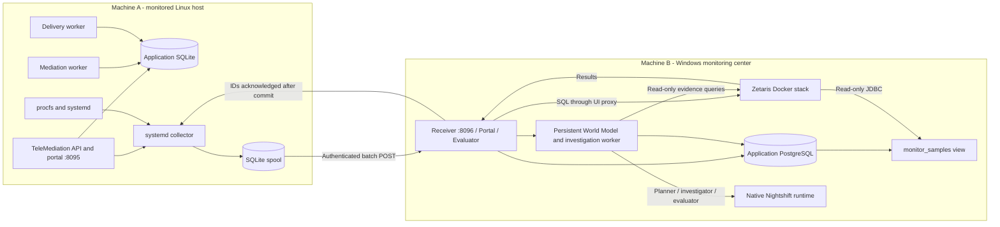

# System architecture

## Two independent machines

The lab uses Linux `192.168.1.202` as machine A and Windows `192.168.1.17` as machine B. Substitute your deployment addresses. Both can be physical machines; a bridged VM is simply one way to deploy A.

## Deployment map

| Machine | Component | Execution | Persistence |
|---|---|---|---|
| A | TeleMediation API and portal | `tmc-api.service` | SQLite |
| A | Validation, normalization and routing | `tmc-mediation.service` | Same SQLite database |
| A | Output-portal publication | `tmc-delivery.service` | SQLite outbox |
| A | Collection and transmission | `tmc-collector.service` | Independent spool |
| B | Ingestion, portal, evaluator thread | `openops-receiver-1` container | PostgreSQL and log volume |
| B | OpenOps application storage | `openops-db-1` container | `openops_openops-data` volume |
| B | Zetaris engine/API/UI | Provider stack | Separate provider volumes |
| B | Meterless Nightshift | Native Windows application | Private runtime configuration |

No model runs on A. The collector accepts no remote commands and does not modify observed services. CPU and memory measurements are real; telecom usage records are synthetic.

## Data flow

1. The collector creates `openops.telemetry.v1` events with UUID, host identity and UTC observation time.
2. It persists each event before transmission and sends up to 50 samples to `/api/ingest`.
3. The receiver validates authentication, host, structure, timestamps and size. It acknowledges IDs only after PostgreSQL commit.
4. Identical retries do not duplicate rows. An ID reused with different content returns 409 and rolls back the entire batch.
5. `observed_at` and `received_at` are separate. Freshness uses observation time rather than arrival time.
6. `monitor_samples` flattens CPU, memory, disk, application reachability and voice-queue metrics. `openops_zetaris` has SELECT permission on this view only.
7. The Zetaris driver reaches PostgreSQL through `openops_default`, without publishing the database port.
8. OpenOps authenticates to the Zetaris UI proxy and queries the latest sample. Monitor transitions retain evidence from that result.

## Alert lifecycle

Normal -> pending -> firing -> recovering -> normal. An alert row is created on firing and retained as history after resolution. Acknowledgement is independent of resolution. A database index prevents multiple open alerts for one monitor.

Repeated or out-of-order observations do not advance counters. Samples older than 60 seconds, prolonged gaps and query failures never establish recovery. Disabling a monitor preserves its open alert. Redefining its condition is refused while that alert remains open.

Resolution means the condition became healthy again. The platform does not enable portals, restart processes or delete queues to repair them. An operator performed the TeleMediation actions in the demonstration.

## AI investigation

World Model organizes entities, declared dependencies and source-linked evidence. Nightshift executes bounded planning, investigation and critique. The worker runs independently of the browser, reports failures explicitly and performs no remediation. See [AI integration](10-ai-investigation.md) for the implemented subset, budget and trace contract.
