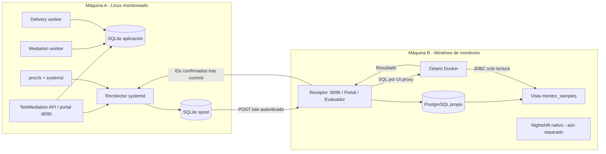

# Arquitectura del proyecto

## Dos máquinas, roles independientes

El laboratorio usa Linux `192.168.1.202` como máquina A y Windows `192.168.1.17` como máquina B. Sustituya esas direcciones por las de su instalación. Pueden ser dos equipos físicos; usar una VM con adaptador puente solo cambia el despliegue de A.

## Qué se ejecuta dónde

| Máquina | Componente | Ejecución | Persistencia |
|---|---|---|---|
| A | API y panel TeleMediation | `tmc-api.service` | SQLite |
| A | Validación/normalización/rutas | `tmc-mediation.service` | Misma SQLite |
| A | Publicación en portales de salida | `tmc-delivery.service` | Outbox SQLite |
| A | Métricas y envío | `tmc-collector.service` | Spool independiente |
| B | Ingesta, portal, hilo evaluador | Contenedor `openops-receiver-1` | PostgreSQL y volumen de logs |
| B | Datos propios de OpenOps | Contenedor `openops-db-1` | Volumen `openops_openops-data` |
| B | Motor/API/UI de Zetaris | Stack del proveedor | Volúmenes propios del proveedor |
| B | Meterless Nightshift | Aplicación Windows nativa | Configuración privada del runtime |

No se ejecuta un modelo en A. El recolector no acepta comandos remotos ni modifica los servicios observados. CPU y RAM son mediciones reales del sistema; los registros de telecomunicaciones son sintéticos.

## Recorrido de datos

1. El recolector forma eventos `openops.telemetry.v1` con UUID, host y fecha UTC de observación.
2. Guarda el evento antes de enviarlo. Envía hasta 50 muestras por petición a `/api/ingest`.
3. El receptor valida autenticación, host, estructura, tiempo y límites; confirma IDs solo tras commit en PostgreSQL.
4. Reenvíos idénticos no duplican filas. Un ID con contenido diferente devuelve 409 y revierte todo el lote.
5. Se conservan `observed_at` y `received_at` separados. La antigüedad se calcula por observación, no llegada.
6. `monitor_samples` aplana CPU, memoria, disco, aplicación y cola de voz. El usuario `openops_zetaris` solo tiene SELECT sobre esa vista.
7. El driver de Zetaris accede a PostgreSQL por la red Docker `openops_default`, sin publicar el puerto de la base.
8. OpenOps inicia sesión en el UI proxy de Zetaris y ejecuta una consulta de última muestra. El monitor cambia de estado con evidencia de esa consulta.

## Alertas

Normal -> pending -> firing -> recovering -> normal. Una alerta se crea al entrar a firing y se conserva como fila histórica al resolver. Reconocimiento es un campo separado. Un índice impide dos alertas abiertas para el mismo monitor.

Una muestra repetida o fuera de orden no avanza contadores. Datos de más de 60 segundos, huecos prolongados o errores de consulta no resuelven alertas. Deshabilitar el monitor conserva las alertas abiertas. No se puede redefinir su condición mientras tiene una alerta abierta.

Resolver significa que la condición volvió a estar sana. La aplicación no habilita portales, reinicia procesos ni elimina colas para repararlos. Las acciones sobre TeleMediation de la demostración las realizó el operador.

## Función futura de IA

World Model organizará entidades/dependencias/evidencias; Nightshift ejecutará investigación y crítica. Este flujo no está implementado. Los documentos de diseño anteriores expresan intención, no ejecución actual.
